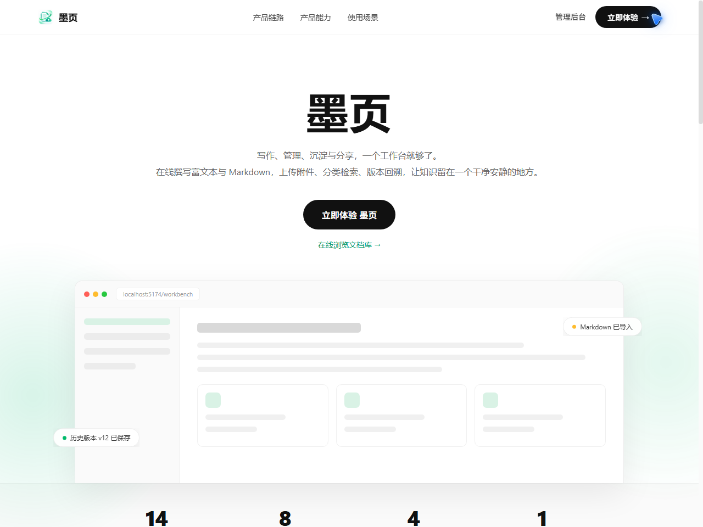
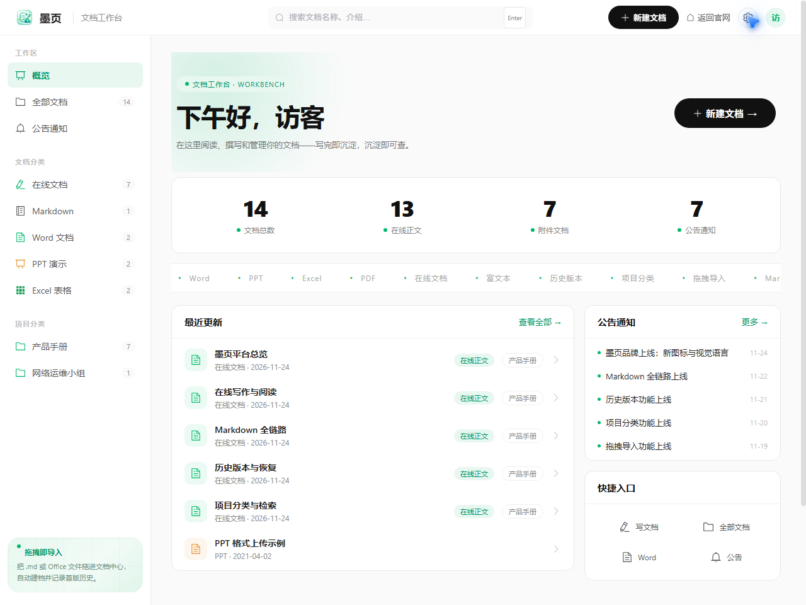
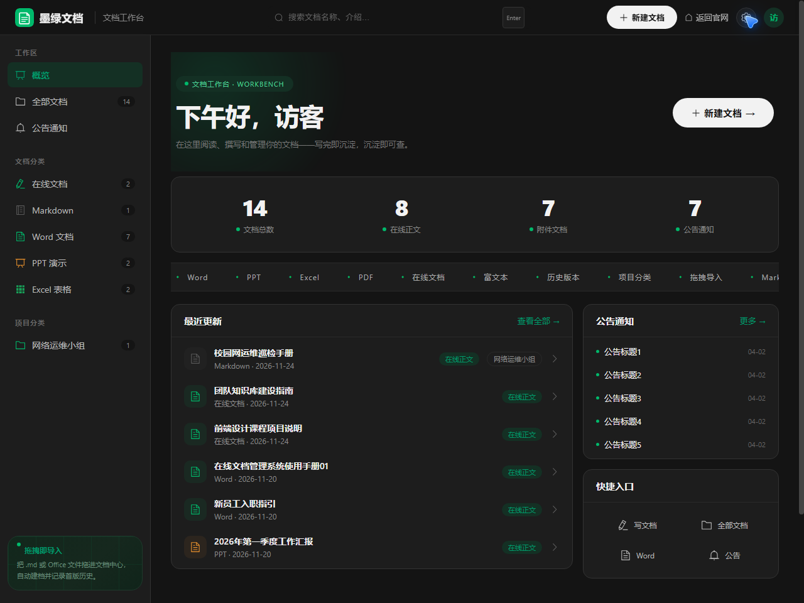

# 墨页 · 在线文档管理平台

轻量在线文档管理平台课程项目：写作、管理、沉淀与分享，一个工作台就够了。

- **后端**：SpringBoot 2.2.2 + MyBatis-Plus + MySQL 8（REST + Token 鉴权）
- **前台**：Vue3 + Vite6 + Element Plus（访客工作台 + 官网落地页，端口 5174）
- **后台**：Vue3 + Vite6 + Element Plus（管理后台，端口 5173）
- **编辑器**：wangEditor 富文本 + md-editor-v3 Markdown 双引擎

## 功能

- 在线写作与纸张式阅读：富文本 / Markdown 双形态，表格、代码块、图片上传
- Markdown 全链路：.md 导入 / 编辑 / 预览 / 下载，整页拖拽导入 Office 与 .md
- 历史版本：保存自动快照、单文档保留 50 版、逐版预览与一键恢复
- 项目分类：跨格式聚合归属，侧栏实时计数，与格式筛选 / 全局搜索叠加
- 附件管理：Word / PPT / Excel 上传、格式徽章、原文件下载
- 外观设置：亮 / 真暗色模式、减少动效、默认视图，localStorage 持久化
- 类型配色参照 Office/WPS 标准：在线文档绿 / Word 蓝 / PPT 橙红 / Excel 深绿

## 目录结构

```
├── front/                 # 前台工作台 + 官网（5174）
├── admin/                 # 管理后台（5173）
├── backend/               # SpringBoot 后端（8080，构件名 springbootpkh49）
├── database/db.sql        # 建表脚本
├── scripts/seed-demo-content.mjs  # 演示内容种子（功能介绍文档 + 产品公告）
├── brand/                 # 品牌图标源图
├── docs/                  # 说明文档与预览截图
│   ├── 预览截图/           # 各轮改版实测截图
│   ├── 前端项目运行说明.md  # 环境、启动、打包与部署
│   └── UI改版说明.md       # 历轮视觉与功能改版记录
├── private/               # 保密材料（gitignore，不入库）
└── archive/               # 原始压缩包存档（gitignore，不入库）
```

## 快速上手

1. MySQL 导入 `database/db.sql`（库名 `springbootpkh49`，账号 root / 123456，可在 `application.yml` 修改）
2. 后端：IDE 运行启动类，或 `mvn package -DskipTests` 后 `java -jar`（端口 8080）
3. 前台：`cd front && npm i && npm run dev` → http://localhost:5174
4. 后台：`cd admin && npm i && npm run dev` → http://localhost:5173（账号 abo / abo）
5. 可选：`node scripts/seed-demo-content.mjs` 重放功能介绍演示内容

## 预览







更多界面见 `docs/预览截图/`，设计与改版细节见 [UI改版说明.md](docs/UI改版说明.md)。