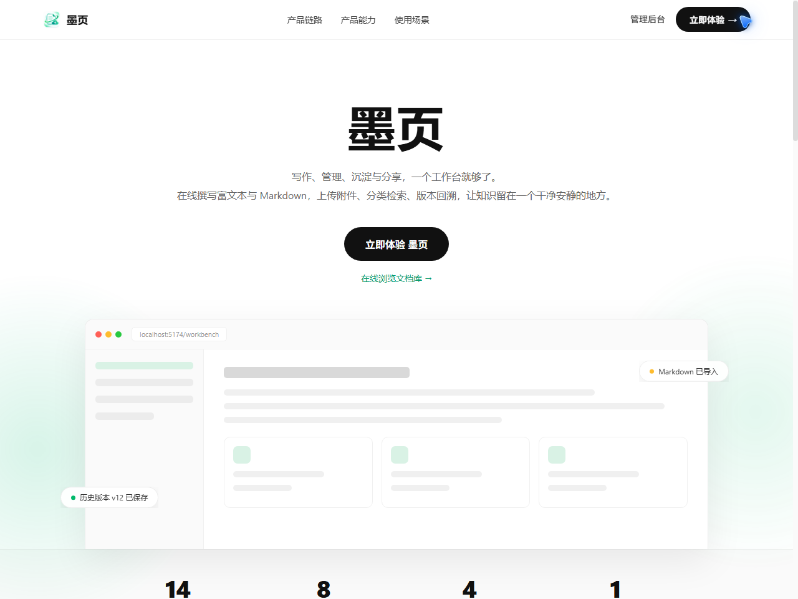
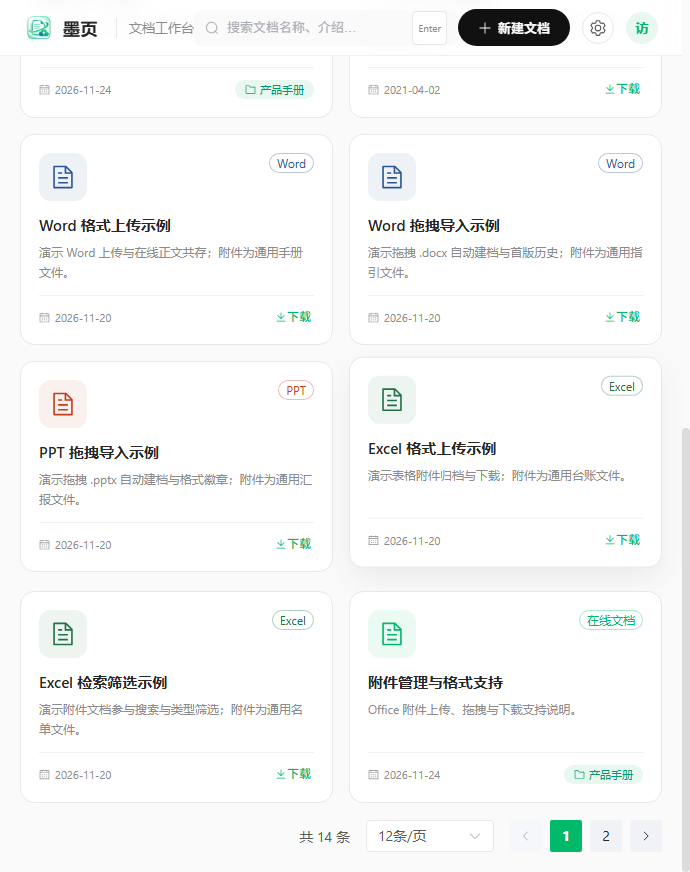

# 墨页 · 在线文档管理平台 — 功能与设计总说明

> 版本：2026-11-27（ID 统一收尾后）
> 用途：一份文档讲清本项目的全部功能、设计决策与工程实现，可直接用于课程答辩 / 项目提交。
> 细节出处：环境启动见 `docs/前端项目运行说明.md`，历轮视觉迭代见 `docs/UI改版说明.md`，本文是两者的合并提炼与最新状态汇总。

---

## 一、项目概述

墨页是一个**轻量在线文档管理平台**：写作、管理、沉淀与分享，一个工作台就够了。项目基于老师提供的 SpringBoot 模板后端进行中改，两个前端（访客工作台 + 管理后台）为**全新重写的 Vue3 项目**，未复用模板自带的 Vue2 后台。

| 层 | 技术 | 说明 |
|---|---|---|
| 后端 | SpringBoot 2.2.2 + MyBatis-Plus + MySQL 8 | REST 接口 + Token 鉴权，构件名 `springbootpkh49` |
| 前台 | Vue3 + Vite 6 + Element Plus | 官网落地页 + 文档工作台，端口 **5174** |
| 后台 | Vue3 + Vite 6 + Element Plus | 管理后台，端口 **5173** |
| 编辑器 | wangEditor 5 + md-editor-v3 | 富文本 / Markdown 双引擎 |

| 入口 | 地址 |
|---|---|
| 官网落地页 | http://localhost:5174/ |
| 文档工作台 | http://localhost:5174/workbench/overview |
| 管理后台 | http://localhost:5173（账号 `abo` / `abo`） |
| 后端 API | http://localhost:8080/springbootpkh49（数据接口，无首页） |

前台访客无需手动登录（静默登录自动续期）；后台路由守卫拦截未登录访问。

---

## 二、系统架构与数据设计

### 2.1 前后端协作

- **Vite 代理**：`server.proxy` 将 `/springbootpkh49` 转发到 `localhost:8080`，开发免跨域、部署同源零改代码；`strictPort: true` 保证端口确定。
- **统一请求封装**：axios 拦截器自动注入 `Token` 头；业务码在 body 的 `code`（0 成功 / 401 未登录）。前台 401 自动静默重登并重试原请求（防死循环标记）；后台 401 提示 3 秒去重、避免并发请求连弹多条。
- **CRUD 工厂**：后端各表接口结构一致（`page/list/info/save/update/delete`），前端 `crudApi(resource)` 工厂生成 API，消除重复代码。
- **路由懒加载** + Element Plus 中文 locale；后台菜单由路由 `meta.group` 自动生成。

### 2.2 数据模型（库 `springbootpkh49`，9 张表）

| 表 | 职责 | 关键设计 |
|---|---|---|
| `wendangxinxi` | 文档主表 | 模板字段之外新增 `neirong`（富文本正文）、`neirongmd`（Markdown 源码）、`xiangmu`（项目归属）；`fujian` 默认 `''` 支持无附件纯在线文档 |
| `wendanglishi` | 历史版本快照 | 每次保存自动写快照，**单篇保留最近 50 版**超量裁最旧；备注区分「编辑保存 / Markdown 导入 / 恢复前自动快照 / 恢复自 …」 |
| `gonggaoxinxi` | 公告 | 内容为富文本，含封面图与发布日期 |
| `users` / `token` | 账号与会话 | Token 鉴权 |
| `bumenxinxi` / `gangwei` / `yuangong` / `config` | 模板组织管理表 | 后台通用表格页维护 |

关键约定（均为实测确认，非猜测）：

- **ID 连续自增**（2026-11-27 统一）：移除模板「时间戳+随机数」13 位 ID 生成逻辑，交数据库自增。现演示数据文档 1–14、公告 1–7，下一序号 15 / 8；历史表外键同步迁移。
- **模糊搜索**：后端 `MPUtil.likeOrEq` 约定为**字段值含 `%` 才 LIKE**，故名称搜索发 `wendangmingcheng=%关键词%`，类型筛选发精确值；`_like` 后缀无效（已纠正并实测）。
- **空值语义**：全局 field-strategy 跳过空串，故富文本/md 互斥清理用空格哨兵 `' '`；`xiangmu` 用 `FieldStrategy.IGNORED` 允许清除归属，代价是 update 必须传完整对象。
- **排序**：`sidx=字段&order=ASC|DESC`，后端做 SQL 注入过滤。

---

## 三、功能总览

### 3.1 前台 · 官网落地页（5174 根路径）

- 白底黑色大标题 + 纯 CSS 绘制的工作台 mockup，能力宣传全部对应真实功能。
- 滚动 reveal 动效、实时数据 countUp、支持格式 marquee、薄荷网格叠卡、黑色页脚描边「墨页」大字。
- 「立即体验」进入工作台；页脚导航与品牌收尾。

### 3.2 前台 · 文档工作台（/workbench）

| 模块 | 功能 |
|---|---|
| 概览 | 欢迎区 + 四指标统计卡（文档总数/在线文档/附件文档/公告，全量统计）+ 最近更新文档（带「在线正文」角标）+ 公告与快捷入口 |
| 文档中心 | 卡片/列表双视图；类型标签筛选（在线文档/Markdown/Word/PPT/Excel，带实时计数）；关键词模糊搜索+命中高亮；日期升降序；分页；**整页拖拽导入**（.md 读文本建档、Office 走上传建档，自动写首版历史） |
| 阅读页 `/workbench/doc/:id` | 纸张式排版（860px 宽、大标题、元信息、简介块）；富文本全局排版（标题/引用/表格/代码块）；Markdown 用 MdPreview 渲染；「下载 .md」Blob 导出；**历史版本抽屉**（逐版预览、一键恢复，恢复前自动快照不丢稿）；无正文时展示附件下载态 |
| 编辑页 `/workbench/new`、`/edit/:id` | 大标题输入 + 类型/日期/附件元信息行 + 简介；按类型切换 wangEditor / MdEditor；「导入 .md」；图片上传；项目下拉 `allow-create` 访客可新建项目；新建/编辑/删除 |
| 项目分类 | 不建新表，用 `xiangmu` 字段跨格式聚合；侧栏实时计数、点击筛选，可与类型筛选/搜索叠加 |
| 公告通知 | 卡片列表（含封面）+ 全文抽屉（富文本渲染） |
| 偏好设置 | 顶栏齿轮 popover：亮色/真暗色、减少动效、默认视图（卡片/列表），localStorage 持久化 |
| 全局搜索 | 顶栏搜索框回车跳转文档中心并带关键词 |

### 3.3 后台 · 管理后台（5173）

| 模块 | 功能 |
|---|---|
| 登录 | `/users/login` + Token 存 localStorage + 路由守卫 |
| 数据看板 | 4 统计卡（文档/部门/员工/公告）+ 最近文档表格（类型彩色标签）+ 快捷操作面板 |
| 文档管理 | 分页列表、名称模糊搜索（% 约定）、类型筛选、新增/编辑/删除、附件上传下载；「正文」列标记在线正文 + 富文本/Markdown 编辑弹窗；「项目」列与表单项目下拉 |
| 公告管理 | 通用表格 + 内容富文本编辑器 + 发布日期选择器 + 封面上传 |
| 部门/岗位/员工/账号管理 | 通用表格页：分页 + 增删改（`SimpleTable` 支持 richtext/date 列类型） |

### 3.4 贯穿双端的能力

- **附件管理**：Word/PPT/Excel/PDF 上传、格式徽章、原文件下载/新窗口打开；演示附件为真实可打开文件，已打入 jar。
- **类型配色**（参照 Office/WPS 标准，双端统一收口于 `api/index.js` 导出）：在线文档 `#00b96b`、Markdown `#595959`、Word `#2b579a`、PPT `#c43e1c`、Excel `#217346`、PDF `#e5484d`。
- **富文本表格**：编辑器与阅读页均支持表格插入与渲染（曾误排除 insertTable，已恢复并实测）。

---

## 四、视觉与交互设计

### 4.1 设计定位与参考取舍

目标是从「学生作业感」升级为**国内大厂文档产品的工作台观感**。参考飞书云文档（导航分组/卡片/列表/悬停操作）、腾讯文档（克制工具栏）、语雀（留白与字体节奏），但**只借鉴视觉语言与信息架构**——协作、权限、目录树等后端撑不起的功能一律不做假功能。

视觉经历三轮演进：飞书蓝 → 墨绿科技风（用户否决）→ **语雀/Notion 式浅色极简（当前生效）**。

### 4.2 设计系统（前后台 styles.css 同一套 CSS 变量，并覆盖 Element Plus 主题）

| 变量 | 当前值 | 说明 |
|---|---|---|
| `--brand` | `#00b96b` | 语雀绿，唯一点缀色 |
| `--bg-page` / `--bg-card` | `#fafafa` / `#fff` | 浅灰页面底 + 白卡 |
| `--text-1/2/3` | `#262626 / #595959 / #8c8c8c` | Notion 灰阶三级文字 |
| `--border` | `#e8e8e8 / #f0f0f0` | 细边框 |
| 圆角 | 4/6/8px | 小圆角，克制 |
| 阴影 | 仅中性极轻阴影 | 删除全部彩色光晕/渐变/玻璃拟态 |

**暗色模式**不是滤镜反色，而是完整双主题 CSS 变量切换；「减少动效」偏好全局关闭 reveal/marquee 等动画。

### 4.3 品牌与图标

- 品牌名「墨页」；图标为用户提供的修订版：薄荷圆角底 + 折角页 + 轨道 + 云上传意象。
- 全套格式落地双端 `public/`：`favicon.svg`（矢量源）、PNG 16/32/48/180、`favicon.ico`；源图存 `brand/logo-source.webp`。
- 使用点：官网导航+页脚、工作台顶栏、后台侧栏、后台登录页、浏览器标签。

### 4.4 页面级设计要点

- **官网**：workbuddy.cn 式动效基因（reveal/countUp/marquee/叠卡/描边大字），但配色服从浅色极简系统。
- **工作台**：「顶栏 + 分类侧栏 + 内容区」三件套；侧栏工作区/文档分类/项目分类三组实时计数；窄屏自动隐藏侧栏；拖拽导入提示卡。
- **阅读页**：纸张式沉浸排版，元信息与简介块前置，正文排版全局 `.rich-content` 统一。
- **后台**：白底侧栏 + 浅绿选中态（取代早期深色侧栏），分组来自路由配置；登录页纯浅灰底白卡 + 品牌图标；看板统计卡彩色图标 + 「实时」角标。

---

## 五、工程与交付物

### 5.1 目录结构

```
前端项目/
├── front/                  # 前台工作台 + 官网（5174）
├── admin/                  # 管理后台（5173）
├── backend/                # SpringBoot 后端（8080）
├── database/db.sql         # 数据库完整基线（结构+演示数据，导入即复现）
├── scripts/seed-demo-content.mjs  # 示例内容种子（功能介绍文档+产品更新日志公告）
├── brand/                  # 品牌图标源图
├── docs/                   # 说明文档 + 预览截图 01–19
├── private/  archive/      # 保密材料与原始存档（gitignore，不入库）
└── README.md               # GitHub 首页概览
```

### 5.2 数据与演示

- `database/db.sql` 为现库导出的完整基线（含历史表与演示数据，剔除 token 会话），换机器导入即可复现；演示内容：文档 14（在线 7 / Markdown 1 / 附件 6）、公告 7、历史 13 条。
- 种子脚本走产品同款 update/save 接口重写示例内容，可重复运行（历史首版按备注去重）。
- 后端运行副本放 `C:\tools\backend\`（避开 OneDrive 同步锁导致 jar 闪退）；改后端后 `mvn package -DskipTests -o -llr` 重打包覆盖重启。

### 5.3 版本与验证

- 公开仓库：https://github.com/JOSNIPER/moye （main 分支，含全部源码与文档）。
- 验证状态：官网/工作台六页/阅读/编辑/历史/公告/暗色/后台登录看板管理逐页浏览器实测通过；两前端 `npm run build` 成功；ID 统一后复验新建、列表、阅读、历史恢复链路。
- 界面存证：`docs/预览截图/` 01–19（含官网首屏、类型配色、表格渲染、ID 统一与历史完好）。





---

## 六、功能边界与工程取舍（答辩必讲）

| 不做的事 | 原因 |
|---|---|
| 浏览器内预览 docx/xlsx/pptx | docx-preview / mammoth / JSZip 多方案在该环境实测全部卡死（Node 端正常），彻底清理依赖，改下载/新窗口打开 |
| 权限管理、目录树、协作评论 | 后端数据模型不支持，硬做就是假功能 |
| 公网服务器部署 | 课程项目定位本机演示；clone + 导库 + 起服务即可完整复现 |

**设计原则：宁可少做，不做假功能——界面上出现的每个按钮都要真的能用。**

安全提示：公开仓库含本地演示口令（root/123456、abo/abo），仅本机演示无实际数据风险；若长期公开作作品集，建议先将口令移出配置文件。

---

## 七、答辩要点速览

1. **信息架构**：工作台范式（全局导航+分类侧栏+内容区）优于传统「顶部菜单+大 Banner」。
2. **设计系统**：CSS 变量统一色彩/圆角/阴影并覆盖 Element Plus 主题，一次定义双端一致；暗色为完整双主题变量。
3. **真·在线文档链路**：写（双引擎）→ 存（longtext 双字段）→ 读（纸张排版）→ 管（后台正文弹窗）→ 沉淀（50 版历史+恢复）。
4. **工程判断力**：区分「可借鉴的视觉语言」与「后端撑不起的功能」；搜索 % 约定、空值哨兵、ID 自增统一等均为读源码+实测确认的约定。
5. **组件化与复用**：crudApi 工厂、SimpleTable 列类型、类型配色单点导出、菜单路由自动生成。
6. **可复现交付**：db.sql 完整基线 + 种子脚本 + README + 19 张实测截图 + 公开仓库。

---

## 附：文档索引

| 想了解 | 看哪里 |
|---|---|
| 全部功能与设计（本文） | `项目功能与设计总说明.md`（根目录） |
| 环境、启动、打包部署、接口约定、踩坑 | `docs/前端项目运行说明.md` |
| 历轮视觉迭代与设计明细 | `docs/UI改版说明.md` |
| 换机器复现、数据基线、功能边界快照 | `docs/项目快速上手.md` |
| 老师原始模板的分析 | `docs/项目初步分析.md` |
| 技术版本选型依据 | `docs/前端技术版本选型.md` |
| 界面存证 | `docs/预览截图/01–19` |